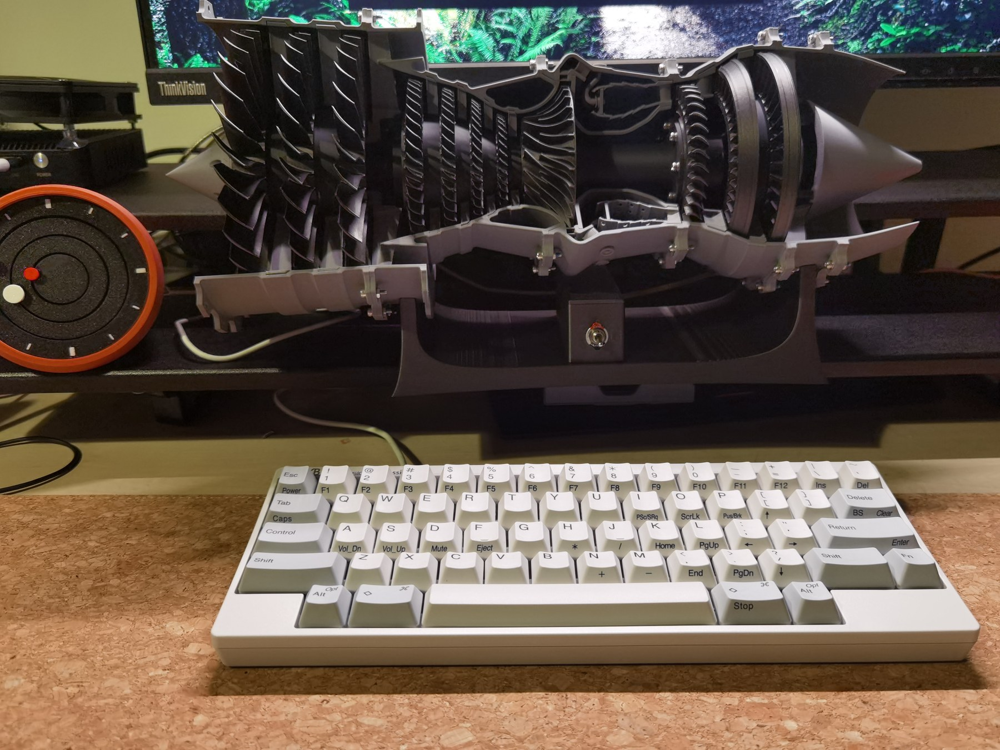
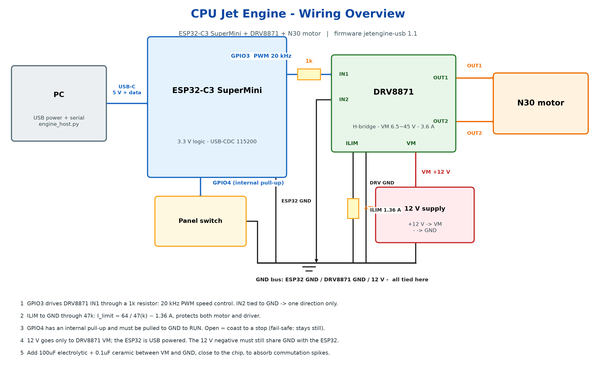
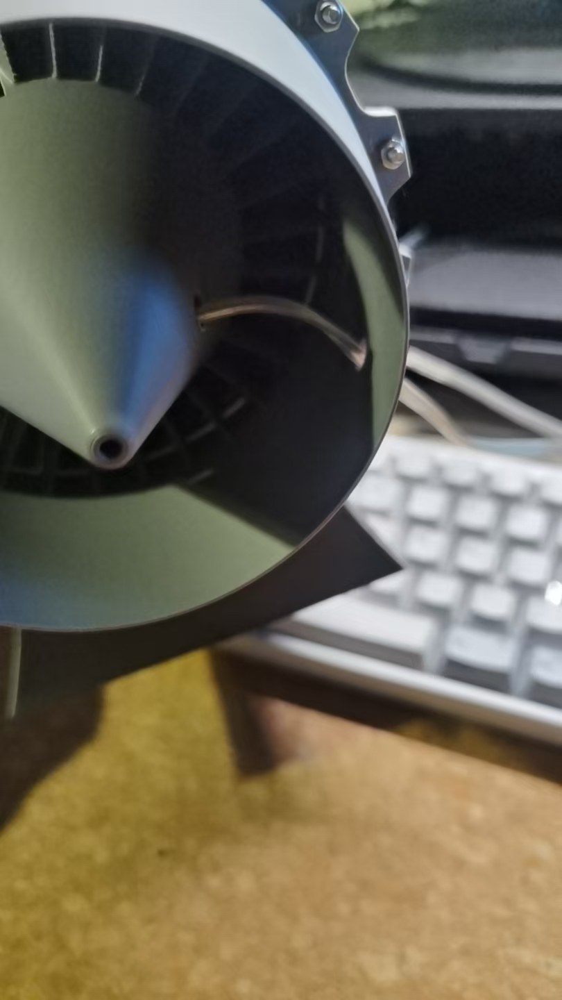
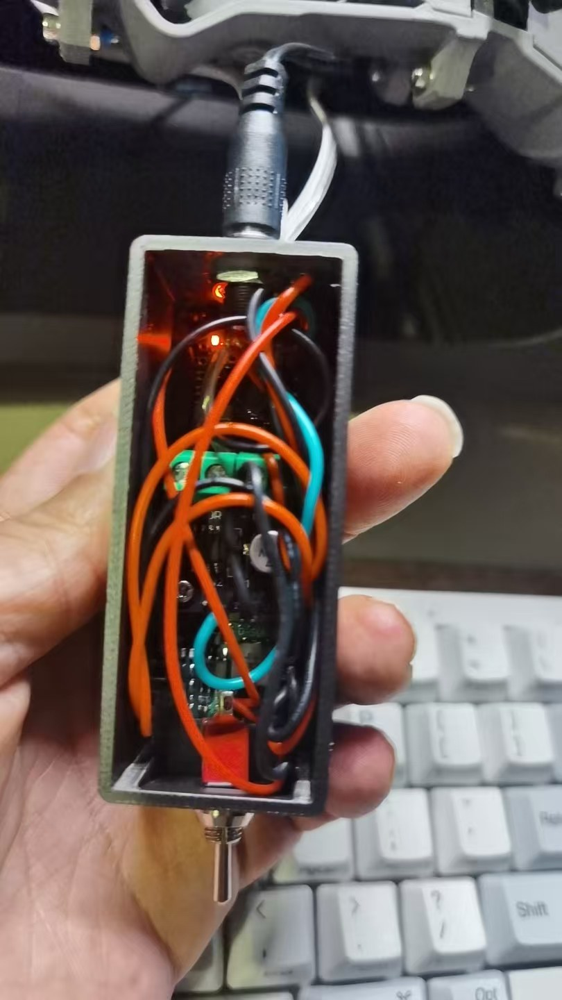

# CPU Jet Engine

A desk-scale jet-engine model whose fan speed follows your computer's **real CPU
load**. A Python script samples CPU utilisation, maps it through a calibrated
curve, and streams the target speed to an ESP32-C3 over USB serial. The ESP32
outputs 20 kHz PWM to a DRV8871 H-bridge driving an N30 DC motor - so the model
spools up when you compile something and winds down when you walk away.

Everything here is module-level wiring: no PCB, no exotic tools. The airframe is
a third-party printed model, not something this repo contains - see below.





## What is in here, and what is not

This repository is the **electronics and software**: firmware, host program,
wiring design, and the documents that describe them.

The printed parts are other people's work and are **not** redistributed here:

- airframe - **3D Printable Low Bypass Turbofan** by **CATIAV5FTW**,
  [MakerWorld 744985](https://makerworld.com/en/models/744985) (CN mirror
  [599135](https://makerworld.com.cn/zh/models/599135)), MakerWorld Exclusive
  License - derivatives may only be published on MakerWorld, with credit
- power take-off - **低旁通涡扇发动机动力组件** by **炒面大师 / @sinnercool**,
  [MakerWorld CN 1455937](https://makerworld.com.cn/models/1455937), CC BY-NC 4.0
- hardware kit - Bambu Lab *Jet Engine Model Components Kit 006* (bearings,
  screws, nuts, washers)

Full attribution, the exact licence terms and what they require of you:
[**CREDITS.md**](CREDITS.md). Note the **non-commercial** term on the printed
power components: a build that includes them is not for commercial use,
regardless of the code licences below.

## How it works

```
PC (Python)                     ESP32-C3 SuperMini            DRV8871            N30
psutil CPU %  --USB serial-->   watchdog + ramp + PWM  --1k-->  H-bridge  --OUT-->  motor
               "T <duty>"       20 kHz, fail-safe            1.36 A limit
```

Design choices worth knowing before you build:

- **All the control logic is on the PC.** Retuning the curve is a JSON edit, never
  a reflash.
- **The link is USB serial, not WiFi.** The same cable flashes the board and runs
  it; no credentials, no network, no pairing.
- **Fail-safe on three levels**: a panel switch that must be closed to GND to
  allow motion, a 2 s command watchdog, and a firmware running floor that keeps
  the motor out of the stall-and-overheat region.
- **Coasting, not braking.** Both driver inputs go low when stopped, so the motor
  spools down the way a turbine does instead of slamming to a halt.

## What you need

| Part | Spec | Qty |
|---|---|---|
| MCU | ESP32-C3 SuperMini | 1 |
| Motor driver | DRV8871 module (H-bridge) | 1 |
| Motor | N30 DC motor | 1 |
| Supply | 12 V DC, 1 A | 1 |
| Resistors | 1 kOhm, 47 kOhm (1/4 W) | 1 each |
| Switch | normally open, to GND | 1 |
| Caps (recommended) | 100 uF electrolytic + 0.1 uF ceramic | 1 each |
| Bearings (suggested upgrade) | 6003ZZ x2 + 6204ZZ x2, metal | 4 | replaces the plastic ones in kit 006 once a power take-off is fitted |

Full list with notes: [`hardware/bom.csv`](hardware/bom.csv).

## Build it in five steps

1. **Wire it** - follow [docs/en/02-assembly.md](docs/en/02-assembly.md) in order:
   signals, then ground, then 12 V, then the motor.
2. **Self-test without the motor** - USB only, open the serial port at 115200, send
   `V` and `P`, then connect 12 V and measure OUT1-OUT2 with `T 50` (should read
   about 6 V). Only then connect the motor.
3. **Flash the firmware** - one command:

   ```bash
   pip install esptool
   esptool.py --chip esp32c3 --port /dev/ttyACM0 --baud 921600 \
       write_flash 0x0 firmware/prebuilt/jetengine_full.bin
   ```

   Or build from source if you want different parameters -
   [docs/en/03-firmware.md](docs/en/03-firmware.md).
4. **Calibrate your motor** - sweep the duty range and set `DUTY_MIN_RUN`, see
   [docs/en/04-host-software.md](docs/en/04-host-software.md#4-calibration-after-changing-the-motor-mandatory).
   The shipped value (15%) is calibrated for an N30 and will not suit every motor.
5. **Run the host**

   ```bash
   pip install -r host/requirements.txt
   python host/engine_host.py            # follows CPU load
   python host/engine_host.py --manual 40  # fixed 40%, bench testing
   ```

## Firmware command reference

ASCII lines over the serial port, terminated with `\n`:

| Command | Effect |
|---|---|
| `T <0-100>` | set target duty; doubles as the heartbeat (2 s without one -> coast to stop) |
| `I` / `S` | idle (80%) / stop |
| `?` / `V` | report status once / version and parameters |
| `P` | pin self test, prints nine GPIO levels |
| `E 1` | bypass the panel switch (debug) |
| `K` | clear fault |

Status is reported at 5 Hz as `R <duty> <target> <state> <ms> <sw>`.

## Tuning the curve

`host/engine_config.json` holds the CPU-to-duty bands, hysteresis and sample
interval. Shipped curve (N30): 8% CPU -> 30%, 25% -> 45%, 50% -> 60%, 75% -> 80%,
100% -> 100%. Retune by editing `bands`, `hysteresis` and `sample_interval`; no
firmware change needed. Two rules: the lowest band must be at or above
`DUTY_MIN_RUN`, and adjacent bands should stay within 25 percentage points.

## Safety

- **12 V must never reach the ESP32.** It goes to DRV8871 `VM` only. The 12 V
  negative still has to be tied to ESP32 `GND`.
- The motor spins a model fan/blade assembly: **keep fingers and loose cables
  clear while it is powered**. With a 1 A adapter its own current limit is the
  protection; on a bigger supply, fit a 1 A fuse on the 12 V feed.
- Do not push motor current through breadboard contacts; use a terminal block or
  solder the joints.
- This is a **desktop model**. It produces no thrust and is not a propulsion
  device of any kind.

## Repository layout

```
docs/en/             English build documentation (start at 01)
docs/zh/             Chinese originals of the same four documents
docs/assets/         wiring diagram (EN + zh-CN)
firmware/jetengine_usb/   Arduino sketch (source of truth for behaviour)
firmware/prebuilt/   merged flashable image + SHA-256
hardware/            BOM + printed control box (control-box-v2.3mf)
host/                PC-side program, sweep tool, config, requirements
tools/               regenerates the wiring diagram figure
CREDITS.md           attribution + licence terms of the third-party 3D designs
```

## Status and known limitations

- Firmware `jetengine-usb 1.1`, built and tested on Debian 13 with
  arduino-cli / esp32 core **3.3.11**; the PC program ran on the same host.
  Windows/macOS steps are identical apart from device names.
- **No audio.** Early sketches of this project mentioned engine sound; this
  release drives motor speed only. The fan and motor noise are the only sound.
- The boot banner prints `jetengine-usb 1.0` - a stale string in the source. The
  `V` command and the status lines report the real `1.1`.
- The wiring diagram is a system-level overview, not a schematic; there is no PCB
  and no CAD source.
- The prebuilt image is for ESP32-C3 with 4 MB flash.

## Additional notes

Notes from the actual build, including the two places where the parts list had to
be improved:

- The airframe was originally assembled with the Bambu Lab **Kit 006**, whose four
  bearings are plastic. Once a power take-off is fitted, replace them with metal
  ones: **2 x 6003ZZ and 2 x 6204ZZ**.
- The power take-off was designed around a **12 V 400 rpm N20**. In testing that
  motor had too little torque: it only started and kept running once the duty
  reached about **80% of rated speed**. With a **12 V 300 rpm N30** it starts at
  about **30%** of rated speed, and band changes are far smoother.
- The rotating assembly has axial play. Before fitting the coupling, push it all
  the way towards the motor, then turn the turbine by hand and confirm the blades
  do not touch the stationary parts. The coupling is fixed to the motor's D-shaft
  with a **3 mm bolt**.
  
- The motor runs from a **12 V 1 A** wall adapter.
- The 3D-printed control box is `hardware/control-box-v2.3mf`. One opening at
  the front takes the toggle switch; the three at the rear are, top to bottom, the
  motor's **5.5 mm DC power jack**, the **motor leads**, and the **USB port**. A USB
  **data** cable from the PC to the box is what makes the speed track CPU load.
- Inside the box, front to back: **DC-DC module, motor driver board, ESP32-C3
  SuperMini**. The modules have pin headers soldered on and are wired with Dupont
  leads. The driver board is held by two 2.5 mm self-tapping screws; the other two
  modules sit in recesses in the floor.
  

## License

Three licenses, matching the three kinds of material:

| Material | License | File |
|---|---|---|
| Code (`firmware/`, `host/`, `tools/`) | MIT | [LICENSE](LICENSE) |
| Hardware design (`hardware/`, `docs/assets/`, circuit docs) | CERN-OHL-S-2.0 | [LICENSE-hardware](LICENSE-hardware) |
| Documentation and figures (`docs/`, README, CHANGELOG) | CC BY-SA 4.0 | [LICENSE-docs](LICENSE-docs) |

Third-party 3D designs (airframe, printed power components, hardware kit) are
**not** covered by any licence in this repository and are not included - see
[CREDITS.md](CREDITS.md).

Chinese version of this README: [README.zh-CN.md](README.zh-CN.md).
