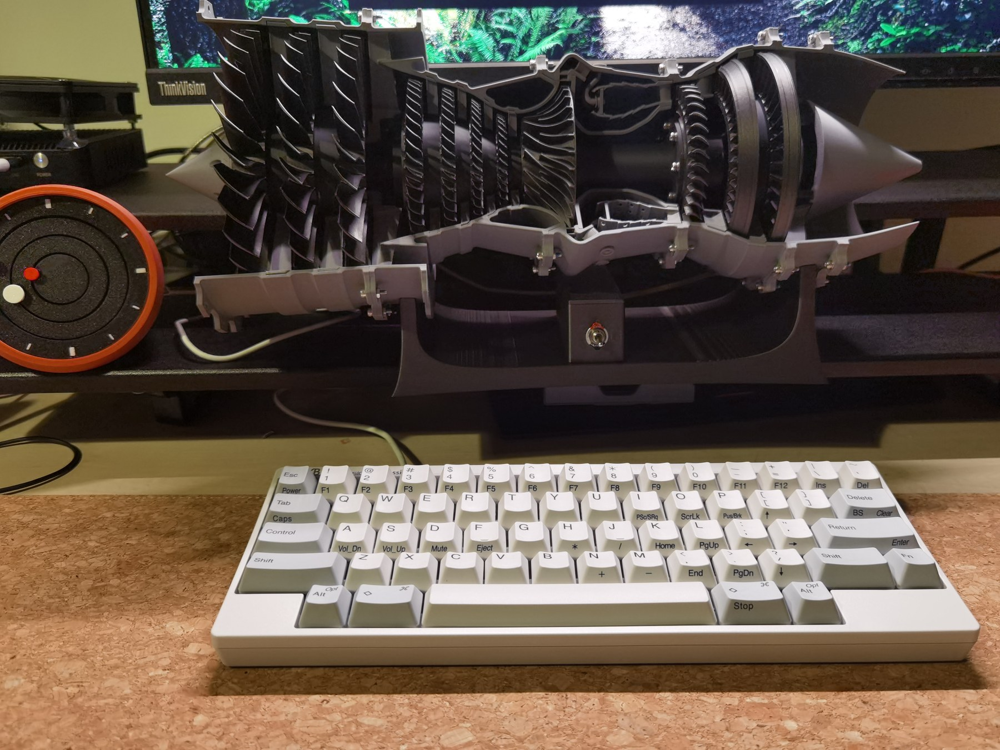
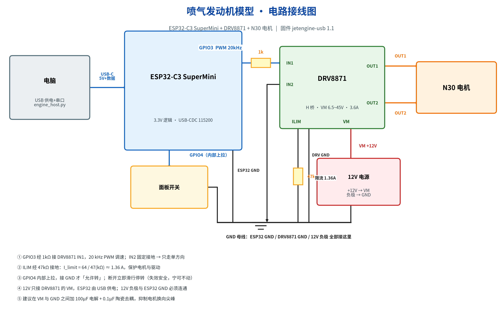
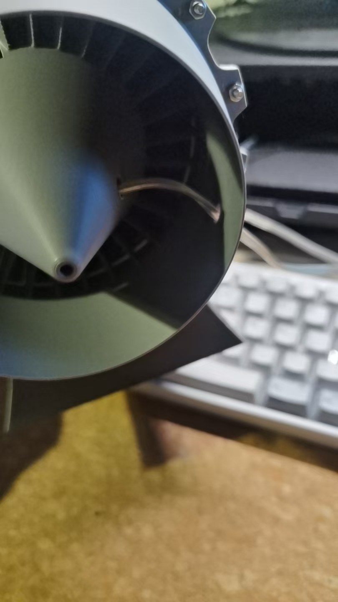
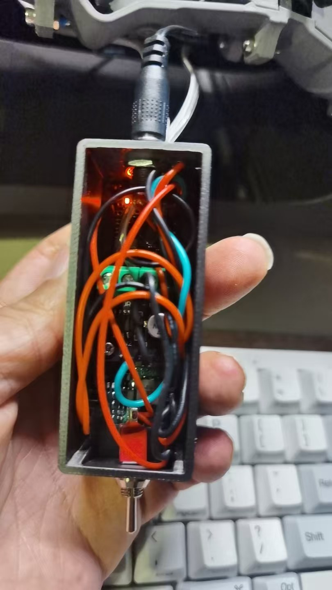

# CPU Jet Engine · 喷气发动机模型

一个桌面尺寸的喷气发动机模型，风扇转速跟着电脑**真实的 CPU 占用率**走。电脑上的
Python 脚本采样 CPU 占用，按标定好的曲线换算成目标转速，通过 USB 串口发给
ESP32-C3；ESP32 输出 20 kHz PWM 给 DRV8871 驱动 N30 直流电机 —— 你编译东西时它
加速，你走开时它慢慢滑行下来。

全部是模块级接线：不需要打板、不需要特殊工具。机身是第三方的打印模型，不在本仓库里 ——
见下节。





英文版说明见 [README.md](README.md)，本仓文档中英各一套。

## 本仓库里有什么、没有什么

本仓库只包含**电子与软件**：固件、电脑端程序、接线设计以及描述它们的文档。

打印件是别人设计的作品，**不在本仓库内分发**：

- 机身 —— **CATIAV5FTW**《3D Printable Low Bypass Turbofan》，
  [MakerWorld 744985](https://makerworld.com/en/models/744985)（国内站
  [599135](https://makerworld.com.cn/zh/models/599135)），**MakerWorld Exclusive
  License** —— 衍生作品只能发布在 MakerWorld 并注明原作者
- 动力组件 —— **炒面大师 / @sinnercool**《低旁通涡扇发动机动力组件》，
  [MakerWorld 中国站 1455937](https://makerworld.com.cn/models/1455937)，**CC BY-NC 4.0**
- 硬件套件 —— Bambu Lab《Jet Engine Model Components Kit 006》（轴承、螺丝、螺母、垫片）

完整的署名、许可证原文条款以及对你的约束：[**CREDITS.md**](CREDITS.md)。
注意动力组件带 **NC（禁止商用）** 条款：包含它的整机不能商用，这与下面代码的授权是两件事。

## 工作原理

```
电脑 (Python)                    ESP32-C3 SuperMini            DRV8871            N30
psutil 读 CPU %  --USB 串口-->   看门狗 + 斜坡 + PWM  --1kΩ-->  H 桥  --OUT-->  电机
                 "T <duty>"      20 kHz，失效安全              限流 1.36 A
```

动手前值得知道的设计取向：

- **所有控制逻辑都在电脑端。** 调曲线是改 JSON，不用重烧固件。
- **链路是 USB 串口，不是 WiFi。** 同一根线既烧录又通信，不用配网、不用配凭证。
- **三层失效安全**：必须把面板开关闭合到 GND 才允许转、2 秒无命令的看门狗、
  固件侧的最低可转占空比下限（防止低速堵转发热）。
- **停机是滑行不是刹车。** 停机时两路输入都拉低，电机会像涡轮一样慢慢降速。

## 需要什么

| 元件 | 规格 | 数量 |
|---|---|---|
| 主控 | ESP32-C3 SuperMini | 1 |
| 电机驱动 | DRV8871 模块（H 桥） | 1 |
| 电机 | N30 直流电机 | 1 |
| 电源 | 12 V 直流，1 A | 1 |
| 电阻 | 1 kΩ、47 kΩ（1/4 W） | 各 1 |
| 开关 | 常开，一端接 GND | 1 |
| 电容（建议） | 100 µF 电解 + 0.1 µF 陶瓷 | 各 1 |
| 轴承（建议更换） | 6003ZZ ×2 + 6204ZZ ×2，金属 | 4 | 装上动力组件后替换 Kit 006 配的塑料轴承 |

带说明的完整清单：[`hardware/bom.csv`](hardware/bom.csv)。

## 五步开做

1. **接线** —— 按 [docs/zh/02-assembly.md](docs/zh/02-assembly.md) 的顺序：
   先信号、再地、最后 12 V 和电机。
2. **不接电机先自检** —— 只插 USB，115200 打开串口，发 `V` 和 `P`；再接 12 V，
   发 `T 50` 用万用表量 OUT1-OUT2（应约 6 V）。确认之后才接电机。
3. **烧固件** —— 一条命令：

   ```bash
   pip install esptool
   esptool.py --chip esp32c3 --port /dev/ttyACM0 --baud 921600 \
       write_flash 0x0 firmware/prebuilt/jetengine_full.bin
   ```

   要改参数就从源码编译：[docs/zh/03-firmware.md](docs/zh/03-firmware.md)。
4. **标定你的电机** —— 扫档后设定 `DUTY_MIN_RUN`，见
   [docs/zh/04-host-software.md](docs/zh/04-host-software.md)。
   仓库里的 15% 是针对 N30 标定的，换电机不能直接套用。
5. **跑主机程序**

   ```bash
   pip install -r host/requirements.txt
   python host/engine_host.py              # 跟随 CPU 占用
   python host/engine_host.py --manual 40  # 固定 40%，纯测电机
   ```

## 固件命令速查

串口里敲 ASCII 行，`\n` 结尾：

| 命令 | 作用 |
|---|---|
| `T <0-100>` | 设目标占空比；同时是心跳（2 秒不发就滑行停转） |
| `I` / `S` | 怠速（80%）/ 停机 |
| `?` / `V` | 立即回报一次状态 / 版本与参数 |
| `P` | 引脚自检，打印 9 个 GPIO 电平 |
| `E 1` | 绕过面板开关（调试用） |
| `K` | 清故障 |

状态以 5 Hz 回报：`R <当前> <目标> <state> <ms> <sw>`。

## 调曲线

`host/engine_config.json` 里是 CPU 分档、迟滞和采样周期。出厂的 N30 曲线：
CPU 8% → 30%，25% → 45%，50% → 60%，75% → 80%，100% → 100%。改 `bands`、
`hysteresis`、`sample_interval` 即可，不用动固件。两条原则：最低档不能低于
`DUTY_MIN_RUN`；相邻档差距不要超过 25 个百分点。

## 安全

- **12 V 绝不能进 ESP32。** 只接 DRV8871 的 `VM`；但 12 V 负极必须和 ESP32
  `GND` 连通。
- 电机会带着模型风扇/叶片转：**上电时手指和松散的线要离开**，12 V 回路建议加
  保险丝的做法：用 1 A 适配器时它自己的限流就是保护；换成更大电源时在 12 V 回路串 1 A 保险丝。
- 电机电流不要走面包板的弹簧片，用端子排或焊牢。
- 这是**桌面模型**，不产生推力，不是任何形式的推进装置。

## 目录结构

```
docs/en/                  英文文档（从 01 开始看）
docs/zh/                  同一套四篇的中文原版
docs/assets/              接线图（中英两版）
firmware/jetengine_usb/   Arduino 源码（行为的唯一依据）
firmware/prebuilt/        合并好的烧录镜像 + SHA-256
hardware/                 元件清单 + 打印控制盒（control-box-v2.3mf）
host/                     电脑端程序、扫档工具、配置、依赖
tools/                    重新生成接线图的脚本
CREDITS.md                第三方 3D 设计的署名与许可条款
```

## 当前状态与已知限制

- 固件 `jetengine-usb 1.1`，在 Debian 13 上用 arduino-cli / esp32 core
  **3.3.11** 构建并验证；电脑端程序也在同一台机器上跑过。Windows/macOS 的步骤
  只差串口设备名。
- **没有音效。** 项目早期设想里提过发动机声音，本版只做电机转速，能听到的是风扇
  和电机的实际声音。
- 启动横幅打印的是 `jetengine-usb 1.0`，是源码里遗留的旧字符串；`V` 命令和状态
  行返回的才是真实的 `1.1`。
- 接线图是系统级总览，不是标准原理图；项目没有 PCB，也没有 CAD 源文件。
- 预编译镜像针对 4 MB Flash 的 ESP32-C3。

## 额外说明

- 喷气发动机3D项目原来使用拓竹Kit006套件，该套件中的四个轴承为塑料轴承，当连接动力组件进行运行时，建议更换为金属轴承，型号为6003ZZ以及6204ZZ，数量各为两个。
- 动力组件原设计为12V 400rpm的N20电机，试验下来扭矩不足，启动转速必须到达额定转速的80%才能启动并维持运行，更改为12V 300rpm的N30电机后，启动转速可以降为30%额定转速，各档切换更加顺畅。
- 喷气发动机转动部分有轴向间隙，连接联轴节前要向电机方向推到头，旋转涡轮叶片确认叶片没有与固定部分擦碰，联轴节与电机D型轴之间的固定采用3mm螺栓。
  
- 电机供电采用12V1A的电源适配器。
- 电机控制盒的3D打印文件见 hardware 目录下的 `control-box-v2.3mf`，前方一个开孔用于安装钮子开关，后方三个开孔，自上而下分别为：电机12V供电接口DC5.5，电机接线，USB接口，需要用一根USB数据线连接电脑和控制盒，才能实现转速跟随CPU占用率变化。
- 电机控制盒内自前向后分别安装DC-DC模块，电机驱动板以及ESP32-C3 SuperMini。模块焊接排针，采用杜邦线连接。除电机驱动板采用两个2.5mm自攻螺丝安装外，其他两个模块嵌入底部凹坑即可。
  

## 授权

三类材料三种授权：

| 材料 | 授权 | 文件 |
|---|---|---|
| 代码（`firmware/`、`host/`、`tools/`） | MIT | [LICENSE](LICENSE) |
| 硬件设计（`hardware/`、`docs/assets/`、电路文档） | CERN-OHL-S-2.0 | [LICENSE-hardware](LICENSE-hardware) |
| 文档与图（`docs/`、README、CHANGELOG） | CC BY-SA 4.0 | [LICENSE-docs](LICENSE-docs) |

第三方 3D 设计（机身、打印动力组件、硬件套件）**不受本仓库任何许可证覆盖**，也不随仓库
分发 —— 见 [CREDITS.md](CREDITS.md)。
